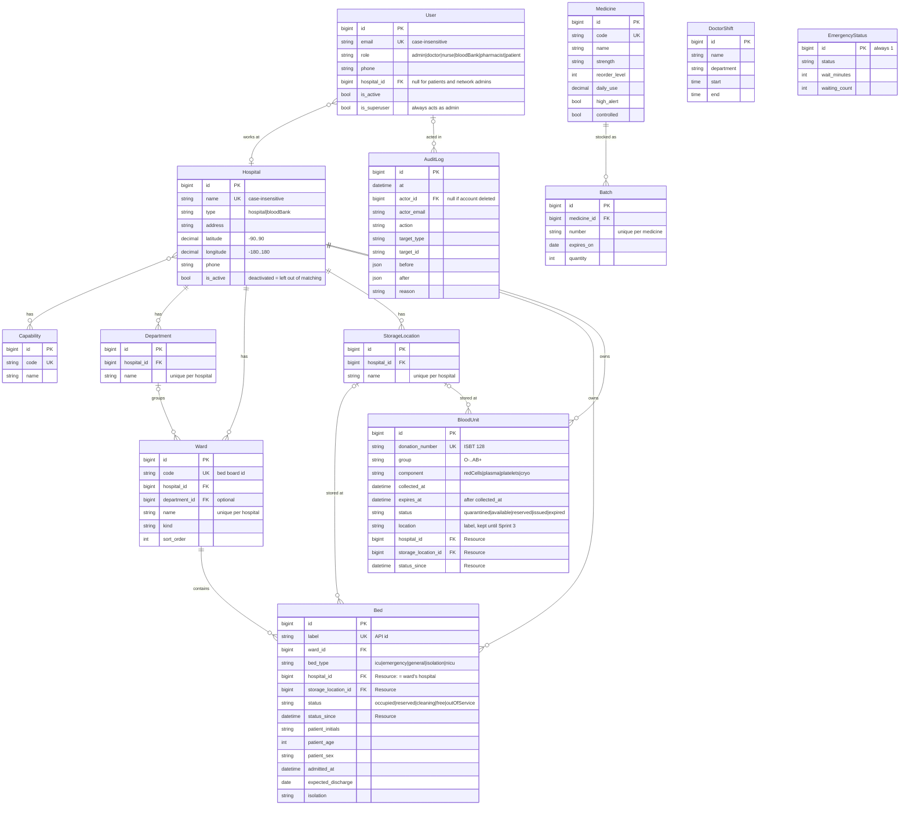
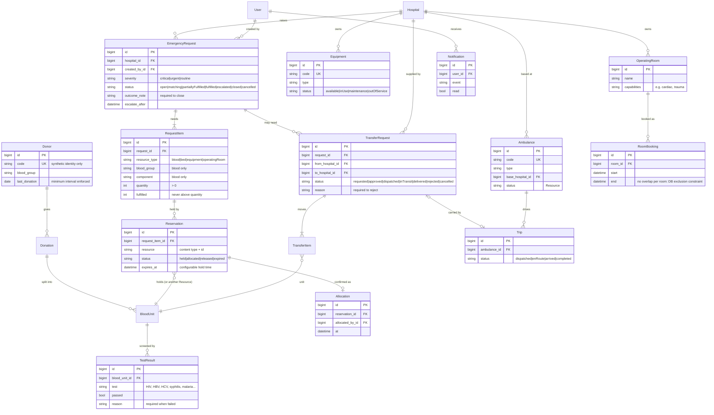

# Entity-relationship diagram

The database as built at the end of Sprint 2, drawn from the Django models in `backend/apps/*/models.py`.
The source is the Mermaid block below; GitHub renders it as a diagram. Update it in the same pull request as any
model change.

The second diagram, [Planned MVP schema](#planned-mvp-schema-proposed), proposes the tables later sprints add.
Together they cover the entities in the proposal's database design (§11): users, hospitals, resources, blood,
requests, reservations, transfers, notifications and audit.

`Bed` and `BloodUnit` share the abstract `Resource` columns (`hospital`, `storage_location`, `status_since`).
See [resources.md](resources.md) for the status lifecycles and the audit log. `Medicine`, `DoctorShift` and
`EmergencyStatus` still belong to the single demo hospital. Tying them to `Hospital` is part of their next stories.

## Planned MVP schema (proposed)

A proposal for the team to review at each story's refinement, not built yet. Names and states come from the
proposal (§11) and the backlog's acceptance criteria. Existing tables appear only by name. Every lifecycle uses
the shared `StateMachine`, and every status change is audit-logged ([resources.md](resources.md)).

Two differences from the proposal's entity list to settle in refinement:

- The proposal lists **Role** as an entity. Roles are a fixed list in code today (`accounts.Role`, see #9).
- The proposal lists **TransferStatusHistory** and **CompatibilityRule**. Status history currently comes from the
  audit log (ADR-7). Compatibility rules are documented in `docs/domain/blood-compatibility.md`, and #37 decides
  whether they become a table.

| Table | App | Sprint | Issues |
|---|---|---|---|
| Donor, Donation, TestResult | blood | 3 | #17–#21 |
| Equipment, OperatingRoom, RoomBooking (Equipment inherits Resource) | resources | 4 | #26–#29 |
| EmergencyRequest, RequestItem | emergencies | 5 | #30–#36 |
| Reservation, Allocation | matching | 6–7 | #38–#45 |
| TransferRequest, TransferItem, Ambulance, Trip | transfers | 7–8 | #47–#51 |
| Notification | notifications | 8 | #52–#53 |
