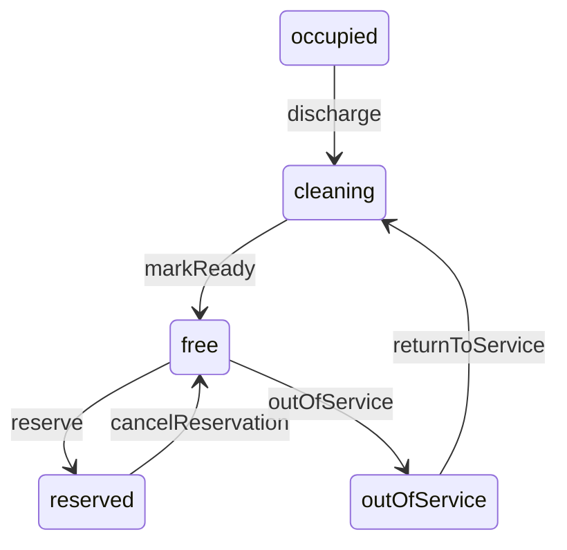
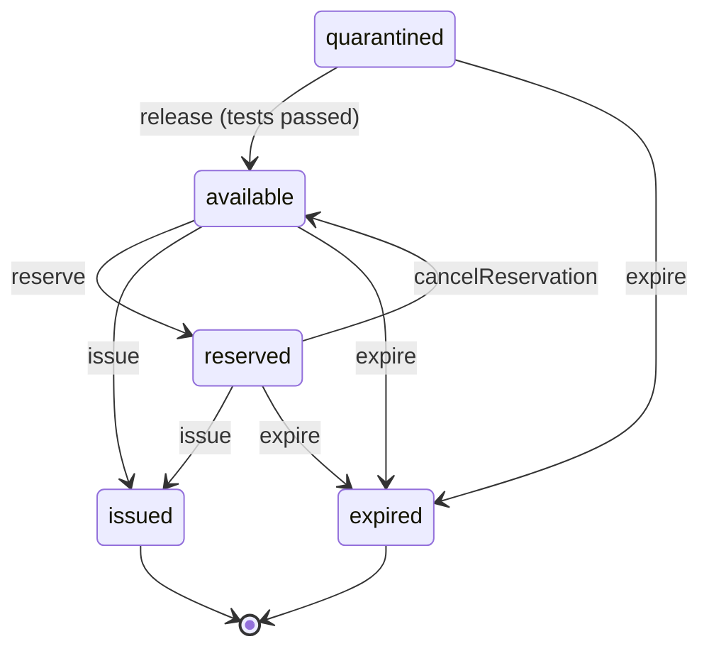

# Shared resources, status lifecycles and the audit log

Design for task 2.0 (*Shared resource model and status state machine*) and story 8.1 (*Audit logging*).
Code: `backend/apps/resources/`, `backend/apps/audit/`.

## The shared `Resource` model (ADR-3)

`apps.resources.models.Resource` is an abstract Django model. Every resource type inherits it:

| Field | Meaning |
|---|---|
| `hospital` | The owning hospital. The own-hospital rule checks this field. |
| `storage_location` | Where it's kept (`hospitals.StorageLocation`), optional |
| `status_since` | When the status last changed |
| `status` | Declared by each subclass, with its own choices |
| `machine` | Class attribute: the subclass's `StateMachine` |

Beds (`hospitals.Bed`) and blood units (`blood.BloodUnit`) inherit it from Sprint 2. Equipment, operating rooms and
ambulances will inherit it in Sprints 4 and 8. A bed's `hospital` always equals its ward's hospital
(`Bed.save()`).

`hospital` is nullable only because Sprint 1 rows had none. `seed_demo` backfills them, the API always sets it,
and a later migration can make it required once every environment has re-run the seed.

## Status changes

Nothing sets `status` directly. Every change goes through one call:

```python
change_status(resource, action, actor=request.user, reason="Incoming trauma patient")
```

It asks the resource's machine for the next status. A move the machine doesn't list raises
`TransitionNotAllowed` (the API answers **409**) and saves nothing. Otherwise it saves the new status and
`status_since` and writes an audit entry `<model>.status_changed`, with who, when, the status before and after,
and why (the reason, or the action name). The caller locks the row first (`select_for_update()` inside
`transaction.atomic()`), so two people can't move the same resource at once.

### Bed lifecycle



Discharging also clears the patient details. Same table as `TRANSITIONS` in `frontend/src/features/beds/beds.ts`.

### Blood unit lifecycle (proposed; Sprint 3 wires it to the API)



Sprint 3's collection and testing story (#18) may add a `discarded` status for failed tests. A unit past its
expiry date already *reads* as expired (`BloodUnit.effective_status`) before anyone records the `expire` move.

The emergency request, reservation and transfer lifecycles get their own machines in Sprints 5–7, built the
same way.

## Own-hospital rule (story 1.2)

`apps.accounts.permissions.may_change(user, resource)`: admins may change any hospital's resources. Everyone else
may change only resources whose `hospital` is their own (`User.hospital`). Otherwise the API answers **403**.
Reads are limited to the user's hospital where a module lists resources (the bed board).

## Audit log (story 8.1, ADR-7)

`apps.audit.services.record(actor, action, target, before=, after=, reason=)` is the one call every module uses.
An `AuditLog` row stores:

- the actor, plus a copy of their email that survives if the account is deleted
- the action, e.g. `hospital.updated`
- the target's type, id and name
- the values before and after, and the reason
- the time

Entries are **append-only**. `save()` on an existing entry, `delete()`, and queryset `update()`/`delete()` all
raise. No API endpoint exposes the log, and Django admin shows it read-only. Search and export come in Sprint 8
(#56).

Logged so far: `user.role_changed`, `hospital.created`/`updated`, `department|ward|location.created`/`deleted`,
`bed.status_changed`.

**ADR-7 (proposed):** the audit log doubles as each resource's status history, so there's no separate history
table. A resource's history is `AuditLog.objects.filter(target_type=…, target_id=…)`, served by an index on
those two columns. If a later screen needs a richer timeline (e.g. transfer tracking), add a dedicated model then.
