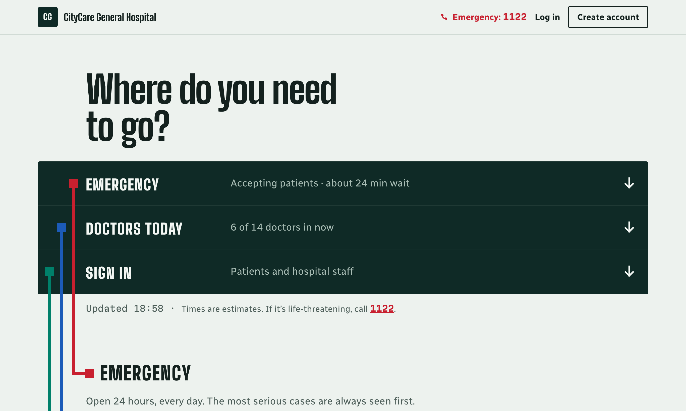
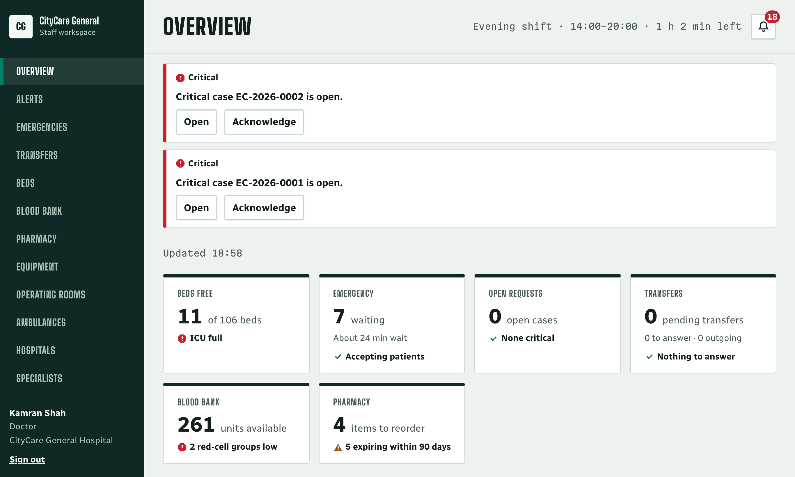
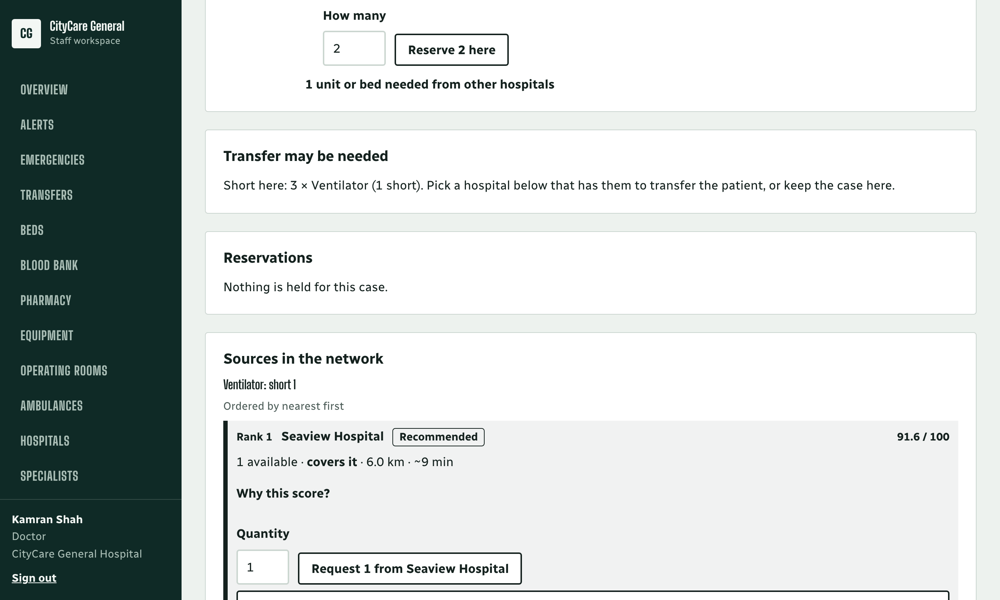
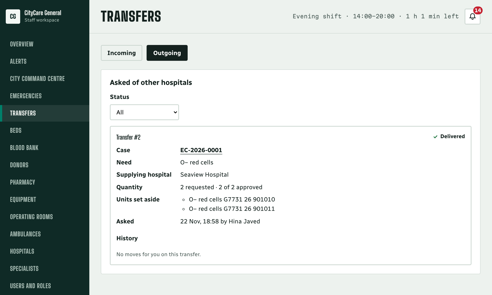
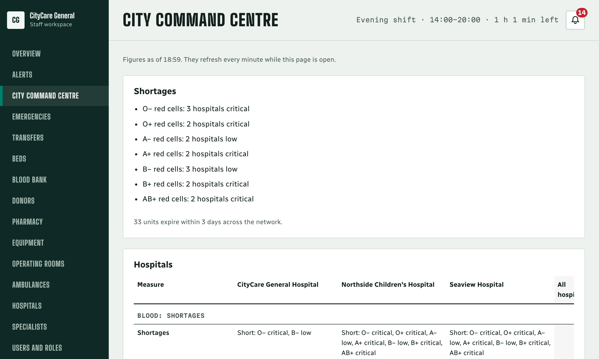
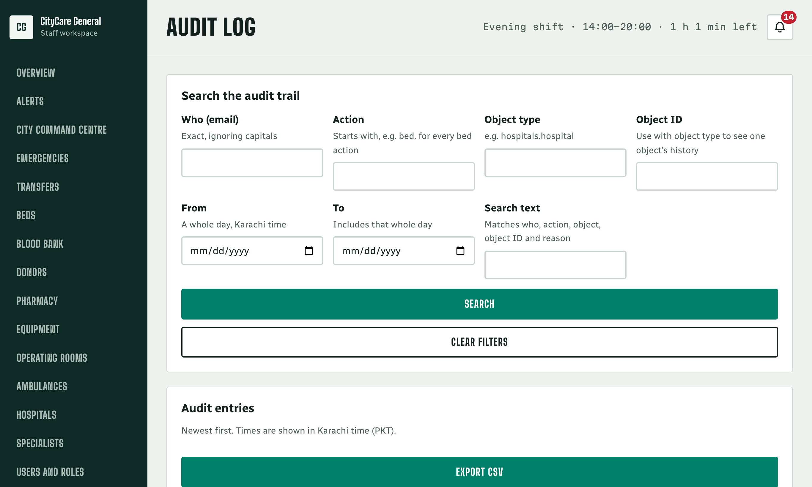
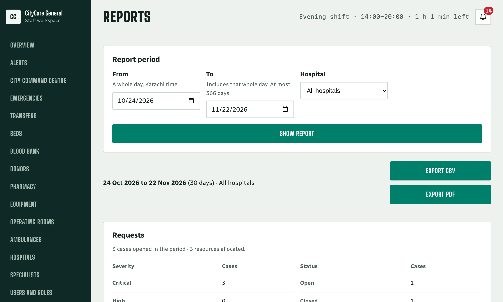
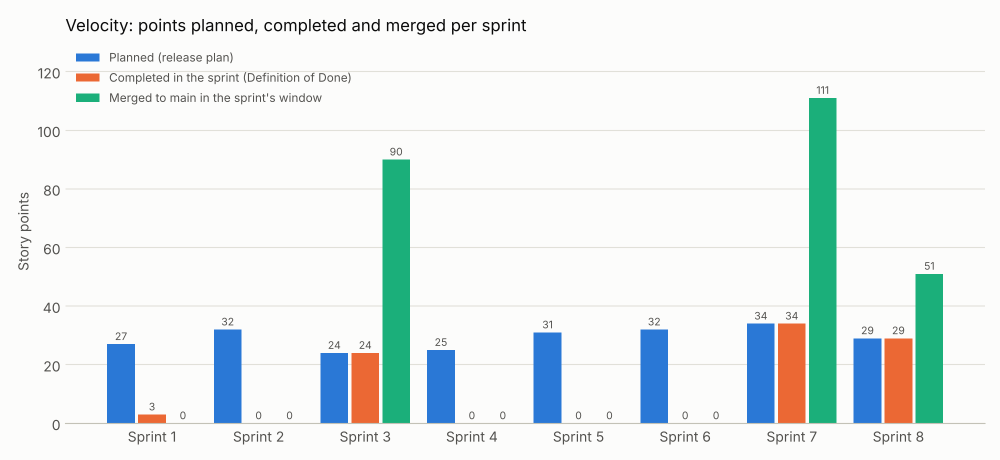
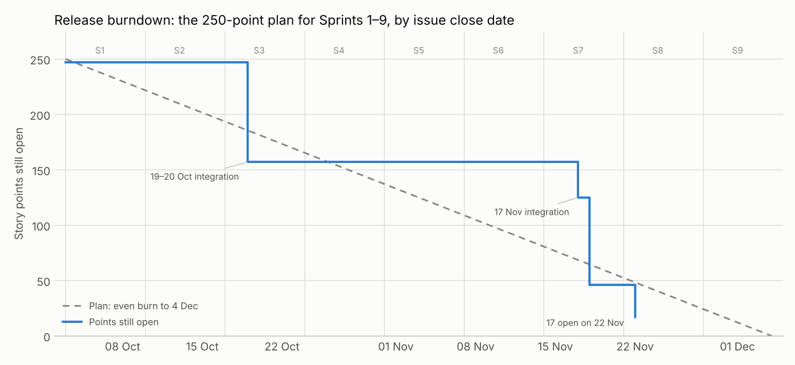

# CityCare: final project report

**Hospital Care (CityCare)**, a city-wide hospital emergency resource coordination platform. Agile Software
Project Management (ASPM) course project, autumn 2026.

| | |
|---|---|
| **Repository** | [harishassan-code/hospital-care](https://github.com/harishassan-code/hospital-care) · [Scrum board](https://github.com/users/harishassan-code/projects/1) |
| **Report state** | 22 Nov 2026, during Sprint 8 of 9. Sprint 8 and 9 records are added after those sprints (section 6) |
| **Prepared by** | Haris Hassan (Scrum Master), with Claude Code. Every figure links to the record it comes from |
| **Data** | All data in the system and in this report's screenshots is synthetic. No real patient data was used |

## Contents

1. [Summary](#1-summary)
2. [Product](#2-product)
3. [Process](#3-process)
4. [Quality](#4-quality)
5. [Lessons learned](#5-lessons-learned)
6. [Sprint records](#6-sprint-records)
7. [Demo](#7-demo)

## 1. Summary

When a patient needs O− blood, a ventilator or an ICU bed that their hospital doesn't have, staff today phone
around. CityCare puts every hospital's stock on one network: a case lists what it needs, the system checks local
stock, ranks the other hospitals that can supply the rest, reserves the units atomically, and tracks the transfer
until the receiving hospital confirms delivery.

| Measure | Result | Source |
|---|---|---|
| Release plan, Sprints 1–9 | 233 of 250 story points closed by 22 Nov; the 17 left are hardening, staging and this report | [burndown](charts/burndown.csv) |
| Stretch goals | All 22 points delivered: specialists (#61, #62), patient transfer (#63–#65), reports (#66, #67) | [velocity table](../../scrum/timeline.md#velocity-check) |
| MVP acceptance criteria (proposal §23) | All 11 covered by the end-to-end browser test; criteria 2 and 4 partly, with the rest in unit tests | [MVP scenario](../../testing/mvp-scenario.md) |
| Automated tests | 1,857 backend tests (10 more run only on PostgreSQL, in CI), 734 frontend tests, 1 end-to-end scenario | section 4 |
| Candidate search speed | p95 about 26 ms on PostgreSQL, 50-hospital network | [load test](../../testing/search-load-test.md) |
| Security | All 66 API routes reviewed; 7 of 10 findings fixed, 1 kept by design, 2 for the Product Owner (#122, #123) | [security review](../../testing/security-review.md) |
| Staging | Configured, not yet deployed (#69). Rehearsed locally with its production settings: the full scenario passes | [rehearsal](../../testing/mvp-scenario.md#against-production-settings-staging-rehearsal-22-nov) |

## 2. Product

### 2.1 Who it's for

- **Hospital staff** (doctors, nurses, blood bank, pharmacy) who open emergency cases and supply or receive stock.
- **Administrators**, who run the network: hospitals, users and roles, the city command centre, audit and reports.
- **The public and patients**, who see the emergency department's status and today's doctors without signing in.

### 2.2 Roles

Six roles: admin, doctor, nurse, blood bank, pharmacist and patient. Access is one table, enforced by the API
(`backend/apps/accounts/permissions.py`) and mirrored in the UI (`frontend/src/features/staff/roles.ts`), and the
two are checked against each other. Staff see and change only their own hospital's records; admins see all. The
table, all 18 modules, is in [api-contracts.md](../../architecture/api-contracts.md).

### 2.3 What shipped

Every module below is merged to `main`, with its tests. Issue numbers link to the backlog; PRs to the code.

| Module | What it does | Issues | Main PRs |
|---|---|---|---|
| Accounts and access | Sign-in with lockout, patient sign-up, six roles, one access table enforced and mirrored | #7–#10, #73, #74 | #81 |
| Hospitals | Registration, departments, wards, storage, capability profiles | #11–#13 | #81 |
| Shared resource model | One status state machine for every stockable resource; audit log of every change | #14, #15 | #81 |
| Blood bank and donors | Units from collection to issue or discard, screening, expiry alerts, donors, eligibility, appointments | #17–#22, #77 | #82–#84, #104 (Donors page) |
| Beds | Bed board, real-time status, capacity | #23–#25, #76 | #81 |
| Equipment and operating rooms | Registries, status, OR scheduling without clashes | #26–#29 | #100 |
| Emergency cases | Cases with blood, bed, equipment and OR needs; severity and priority; local availability; status, escalation and closure; network blood feed | #30–#36 | #100 |
| Matching engine | Blood compatibility from a documented table; candidate hospitals; distance and travel time; configurable scoring; ranked, explained results; multi-resource | #37–#42 | #100 |
| Reservations and allocation | Atomic holds that expire, concurrency tests on PostgreSQL, allocation records, blood allocation queue | #43–#46 | #100 |
| Transfers | Request, approve, dispatch, in transit, delivered; tracking; cancellation releases holds | #47–#49 | #102 |
| Ambulances | Registry; dispatch with an ETA, trip steps, one active trip per ambulance | #50, #51 | #104 |
| Notifications and alerts | Event notifications inside each transaction; bell, critical banners, alerts page | #52, #53 | #104 |
| Dashboards | Hospital overview with live refresh; city command centre (admins) | #54, #55, #75 | #104 |
| Audit | Search and CSV export, admins only, capped and formula-safe | #56 | #104 |
| Specialists *(stretch)* | Directory with on-call windows and an "available now" filter | #61, #62 | #109 |
| Patient transfer *(stretch)* | Need check, destination choice, arrival moves the case | #63–#65 | #106 |
| Reports *(stretch)* | Requests, fulfilment time and wastage for a period; CSV and PDF export | #66, #67 | #112, #119 |
| Public landing page | Live emergency status and today's doctors | #72 | #81 |

### 2.4 Architecture

A Django 6 and Django REST Framework API on PostgreSQL, one app per module, and a React 19 and TypeScript single-page
app. Full detail, including the data model, is in [docs/architecture](../../architecture/README.md); the rules every
change follows are in [AGENTS.md](../../../AGENTS.md). The ones that shaped the design:

- **Business rules live in services**, not views. Every endpoint names a permission class and has a test.
- **Every status change goes through a state machine**, and anything that moves stock runs in one transaction with
  row locks taken in a fixed order, so two hospitals can't reserve the same unit.
- **Every state change is audit-logged**, and the log can't be edited or deleted.
- **One access table in two places**, kept identical (a script checks it).

### 2.5 Screenshots

Taken from a local run of the seeded app after the full MVP scenario, at 1366 × 820. Staging screenshots replace
them once staging is deployed (#69).

| | |
|---|---|
|  Public landing page |  Hospital overview (doctor) |
|  A critical case, one ventilator short |  The network's ranked sources, with score, distance and travel time |
|  Transfers, delivered |  City command centre (admin) |
|  Audit log (admin) |  Operational reports (admin) |

### 2.6 What was not built, and why

All stretch stories in the backlog were built. What wasn't built is what the WBS and feature breakdown describe
but the backlog never scheduled: a password reset flow, email notifications, required-by times on requests, a city
map, ambulance crews and auto-dispatch, OR rescheduling and others. They are listed in priority order, with today's
state of each, in the [handover note and roadmap](../handover-and-roadmap.md#4-future-roadmap-wbsfbs-items-not-built).
Two security findings need a Product Owner decision before any real hospital joins: doctors' names on the public
page (#122) and pharmacy stock without a hospital scope (#123).

## 3. Process

### 3.1 Team

Eight students; the roster and roles are in [team.md](../../scrum/team.md), where each member adds their own row
(#2). Merged pull requests by GitHub account, from the repository: harishassan-code 11, codewithalphadotcom 6,
Kabir-Raj-01 6, Hassan27521 5, muhammadHassaanTD 1. The WBS and backlog were written by Muzammil Siddiqui. The
Product Owner is the course instructor.

### 3.2 Scrum set-up

One-week sprints from Saturday to Friday, nine in all (3 Oct to 4 Dec), with planning, review and retrospective on
Friday evenings. The [working agreement](../../scrum/working-agreement.md) sets the Definition of Ready, the
Definition of Done (merged to `main`, tests and CI green, reviewed) and a limit of two items in progress per person.
The backlog lives on the GitHub Project board, one milestone per sprint. The release plan is in the
[timeline](../../scrum/timeline.md).

### 3.3 AIDLC: how AI-assisted work was run

The AIDLC process arrived in Sprint 6 (#91), and from Sprint 7 (#101) the team ran the remaining work as **bolts**: short cycles with three gated phases. Inception writes
a spec and proposes answers to its open questions, and no code is written until the spec is approved. Construction
writes a plan of small units and builds them, gated by PR review. Operations writes notes once it's live on staging.
The process, templates and a worked example are in [docs/aidlc](../../aidlc/README.md), and the
[bolt board](../../aidlc/bolts/README.md) tracks all 19 bolts. AI assistants follow [AGENTS.md](../../../AGENTS.md),
which also requires the human owner to be credited as a commit's author.

How it worked in practice:

- **Specs and plans were written for every bolt**, and the bolt board was kept in step by CI.
- **The approval gate was weaker than designed.** Specs B12–B18 were signed by the developer who wrote them, and
  B01–B11's sign-off lines still say "pending" for the Product Owner. The PR review was the effective gate.
- **Operations notes wait for staging.** No bolt has them yet, because staging isn't deployed.

### 3.4 Where the plan and the delivery differed

The velocity chart shows the clearest difference. Throughput matched the plan, about 29 points per sprint against
about 27 planned. But work reached `main` in **two big integrations** instead of each sprint: 19–20 Oct (Sprints 1–3,
90 points) and 17–18 Nov (Sprints 4–7, 111 points). Five sprint reviews had nothing new on `main` to demonstrate.

The burndown shows the same two steps, then the Sprint 8 merges on 22 Nov:

The numbers behind both charts are in [velocity.csv](charts/velocity.csv) and [burndown.csv](charts/burndown.csv),
and `python3 scripts/velocity_charts.py` rebuilds them. Velocity comes from the
[timeline table](../../scrum/timeline.md#velocity-check) (points reaching `main`); the burndown uses issue estimates
and close dates from a [GitHub snapshot](charts/issues.csv), so their totals differ slightly. Burndown screenshots
weren't captured during Sprints 1–7, so this chart is rebuilt from the record.

Other differences, from the repository's history:

- **Sprints 4–7 landed as one integration PR (#100)**, which replaced seven open PRs. Squash-merged, it is credited
  in GitHub's statistics to the person who opened it, not to the people who wrote the code. Its commit message names
  the co-authors.
- **Parallel work collided.** Two implementations of the ambulance bolts were opened (#104 and #110); #110 was closed.
  On 22 Nov the six PRs that remained after #104 all conflicted with `main` and with each other. They were merged in
  priority order, with each conflict fix tested on the state it produced, including the full browser scenario.
- **The flaky tests surfaced on `main`.** Two timing-dependent frontend tests failed at random after the Sprint 8
  merges; both were fixed the same day (#115, #120).
- **Staging is not deployed** (#69). Its configuration is checked in CI, and the deploy needs the account owner.
  On 22 Nov the whole browser scenario passed against the same settings run locally (DEBUG off, gunicorn, HTTPS-only
  cookies, behind a proxy like Vercel's), so the deploy itself is the remaining risk:
  [rehearsal](../../testing/mvp-scenario.md#against-production-settings-staging-rehearsal-22-nov).

## 4. Quality

### 4.1 Automated tests

| Suite | What it covers | Size |
|---|---|---|
| Backend (pytest) | Services, API, permissions for every route, state machines, seed data | 1,857 tests on SQLite; 10 more need PostgreSQL and run in CI |
| Concurrency (pytest, PostgreSQL) | Two reservations, allocations or transfers racing for the same unit | In the 10 above |
| Frontend (Vitest) | Pages, components, the API client and the access table, against a mock of the real API shape | 734 tests |
| End-to-end (Playwright) | The MVP acceptance scenario: three hospitals, a critical blood request, local holds, ranked sources, a transfer through delivery, allocation, closure, and the history in the audit log | 1 scenario, 12 steps |

The end-to-end scenario maps each step to the proposal's §23 criteria, in
[mvp-scenario.md](../../testing/mvp-scenario.md). Criteria 2 and 4 are partial in the browser (there is no
blood-bank login at the partner hospitals, and negative matching cases are in the unit tests); the rest are covered.

### 4.2 Continuous integration

Every push and pull request runs four jobs ([ci.yml](../../../.github/workflows/ci.yml)):

- **backend:** lint, migration check, the test suite on PostgreSQL 17, and Django's deployment check with DEBUG off.
- **frontend:** lint, tests and a type-checked build.
- **deploy-config:** the Render and Vercel settings agree, and the bolt board is up to date.
- **e2e:** the full browser scenario against PostgreSQL, run on pull requests and on `main`.

### 4.3 Security

The review in [security-review.md](../../testing/security-review.md) lists every one of the 66 API routes with its
permission and hospital scope, and two tests walk every route to keep it that way. Seven of its ten findings are
fixed: donors and records at
other hospitals now answer 404 rather than leaking their existence, sign-in and sign-up are rate-limited per address,
the server refuses to start without a secret key, HTTPS and HSTS are on in production, and the Django admin is off on
staging. One finding is kept by design (some reads also run housekeeping), and two need a Product Owner decision
(#122, #123). The deploy check on staging waits for #69.

### 4.4 Performance

The candidate search (the matching engine's main query) was load-tested over HTTP on a 50-hospital network with one
server worker, as Render runs it. On PostgreSQL 16 the p95 is **about 26 ms** with one client and **108 to 139 ms**
with five at once, with no errors in 1,200 requests. A search makes 10 queries whatever the network size. Method,
dataset and versions are in [search-load-test.md](../../testing/search-load-test.md).

### 4.5 Acceptance

The [UAT checklist](../../testing/uat-checklist.md) has one row per MVP story for the Product Owner to sign on staging.

## 5. Lessons learned

From the retrospectives ([Sprints 1–7](#6-sprint-records)), reconstructed from GitHub by bolt B00:

1. **Merge each story within its sprint.** Every retrospective records it. Large end-of-cycle integrations hid
   progress from reviews and turned merges into conflict resolution.

From the record of Sprints 7 and 8, for the team to confirm at the Sprint 8 retrospective:

2. **One owner per bolt, visible before work starts.** Two teams built the same feature (#104, #110), and fixes were
   written twice in a day. Claiming the bolt on the board first would have prevented both.
3. **Squash-merge only PRs whose author wrote the code.** An integration PR that carries other people's commits
   should be merged with a merge commit, or GitHub credits all of its lines to one person.
4. **Treat a flaky test as a bug on the day it appears.** Two timing races in the frontend tests turned `main` red at
   random until they were fixed.
5. **The spec gate needs someone other than the author.** A self-signed spec is a plan, not an approval.

## 6. Sprint records

| Sprint | Dates | Planning | Review | Retrospective |
|---|---|---|---|---|
| 1 | 3–9 Oct | [planning](../sprint-01/sprint-planning.md) | [review](../sprint-01/sprint-review.md) | [retro](../sprint-01/retrospective.md) |
| 2 | 10–16 Oct | [planning](../sprint-02/sprint-planning.md) | [review](../sprint-02/sprint-review.md) | [retro](../sprint-02/retrospective.md) |
| 3 | 17–23 Oct | [planning](../sprint-03/sprint-planning.md) | [review](../sprint-03/sprint-review.md) | [retro](../sprint-03/retrospective.md) |
| 4 | 24–30 Oct | [planning](../sprint-04/sprint-planning.md) | [review](../sprint-04/sprint-review.md) | [retro](../sprint-04/retrospective.md) |
| 5 | 31 Oct – 6 Nov | [planning](../sprint-05/sprint-planning.md) | [review](../sprint-05/sprint-review.md) | [retro](../sprint-05/retrospective.md) |
| 6 | 7–13 Nov | [planning](../sprint-06/sprint-planning.md) | [review](../sprint-06/sprint-review.md) | [retro](../sprint-06/retrospective.md) |
| 7 | 14–20 Nov | [planning](../sprint-07/sprint-planning.md) | [review](../sprint-07/sprint-review.md) | [retro](../sprint-07/retrospective.md) |
| 8 | 21–27 Nov | to add | to add after 27 Nov | to add after 27 Nov |
| 9 | 28 Nov – 4 Dec | to add | to add after 4 Dec | to add after 4 Dec |

The Sprint 1–7 records were reconstructed from GitHub; fields GitHub doesn't hold (attendance, Product Owner
feedback, mood) are marked for the team to confirm.

## 7. Demo

The final demo follows the [demo script](../../setup/demo-script.md): a critical case needs three ventilators, its
hospital has two, and the network finds, moves and confirms the third. The slides are in
[final-presentation.pptx](final-presentation.pptx).
